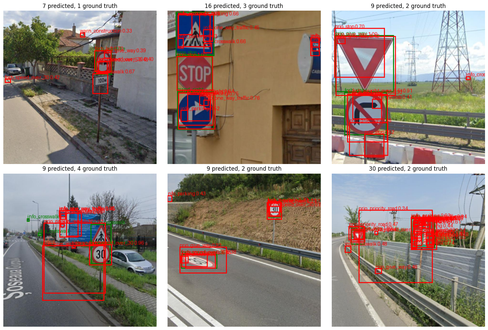
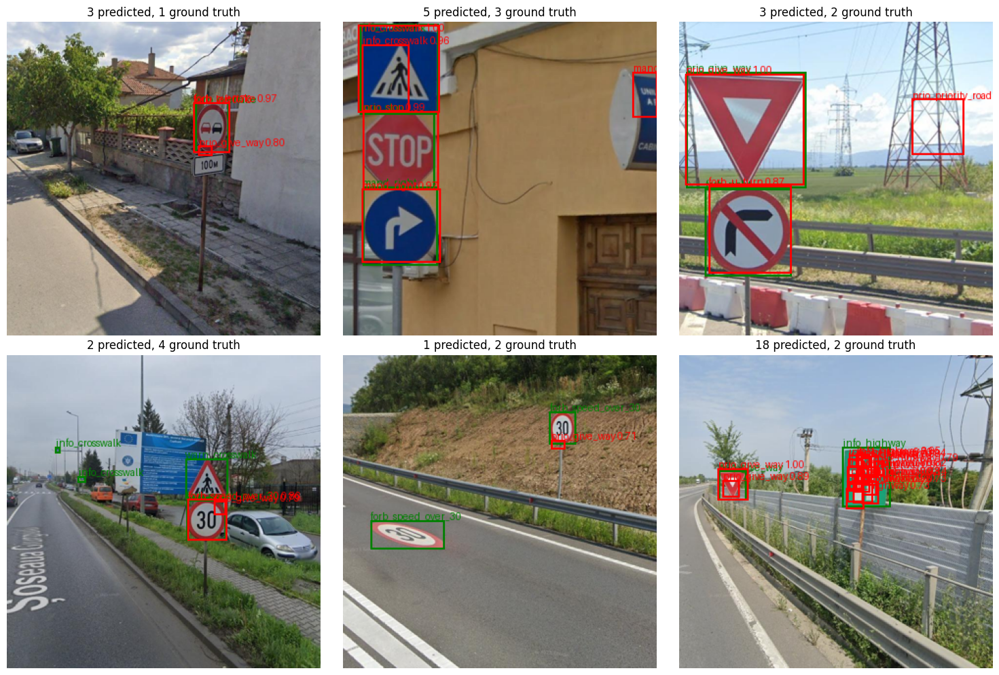
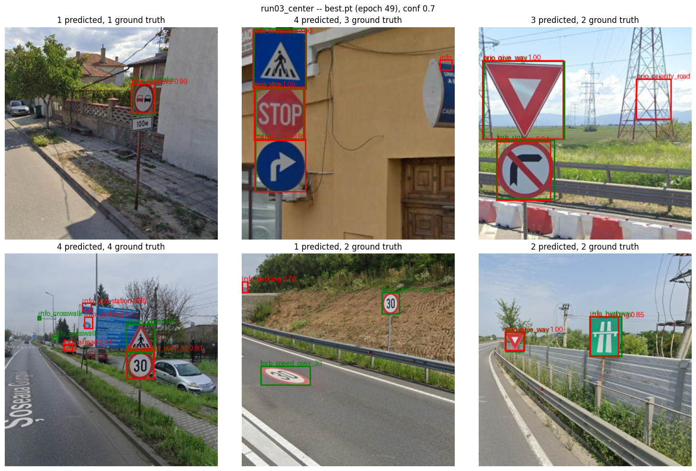

# yolo-edge-quantization

A YOLO-style object detector, built from scratch in PyTorch, trained on a real
traffic-sign dataset, then quantized and benchmarked for CPU/edge deployment.

**Status: in progress.** Current best: **val mAP@0.5 = 0.293**, trained from scratch
for 50 epochs (run03; up from 0.156 for the first working run -- see
[Results](#results)). Getting a first working model took fixing three bugs that kept
mAP at exactly 0 (see [Debugging the first runs](#debugging-the-first-runs)). Next:
one long training run with the settled recipe, then the YOLOv8n baselines -- see
[Roadmap](#roadmap).

## Goal

The aim is to separate out, honestly, what each piece of a modern detector actually
buys you: the architecture itself, the training recipe, and pretraining. Building
the detector from scratch and comparing it against a reference implementation under
matched conditions is how this project tries to answer that:

1. **This repo's model**, trained from scratch.
2. **Ultralytics YOLOv8n**, trained from scratch on the same data.
3. **Ultralytics YOLOv8n**, fine-tuned from COCO-pretrained weights.

(1) vs (2) isolates how close a from-scratch reimplementation gets to a mature
reference architecture under identical conditions. (2) vs (3) isolates the value of
pretraining, which (1) can't replicate but can be measured against. The final
deliverable quantizes and benchmarks this repo's own model (PyTorch -> ONNX -> ONNX
Runtime, FP32 vs FP16 vs PTQ INT8 vs QAT INT8) on CPU.

## Architecture

Multi-class, multi-scale, anchor-free detector in the YOLOv8 family:

```
image --> Backbone --> P3, P4, P5 (strides 8/16/32)
                 \
                  --> Neck (FPN top-down + PAN bottom-up) --> 3 refined feature maps
                                  \
                                   --> Head x3 (one per scale) --> (box, obj, cls) per cell
```

- **Backbone**: stride-2 `Conv` + `C2f` blocks, channel-doubling on every downsample,
  topped with `SPPF`.
- **Neck**: upsample + concat + `C2f` (top-down), then downsample + concat + `C2f`
  (bottom-up) -- lets every scale see both fine detail and deep semantics.
- **Head**: per scale, a shared conv trunk splits into three branches -- box
  regression (4 channels, `(l,t,r,b)` distances from the cell center), objectness
  (1 channel), and classification (`num_classes` channels). Originally merged
  objectness into the class scores (YOLOv8's actual design), with focal loss to
  offset the resulting ~1:20,000 positive:negative cell ratio at train time; in
  practice this didn't converge within budget, so objectness was decoupled back out
  (YOLOv1-v5 style) -- classification loss is now computed only at positive cells,
  removing it from facing that imbalance at all, rather than just reweighting it.
  Caveat: the merged design was judged with an evaluation bug in place (bug 1 below),
  so it was never given a fair comparison.
- **Loss**: L1 box loss at positive cells; classification BCE summed over classes and
  normalized per positive cell; objectness BCE with positive and empty cells averaged
  separately. Both normalizations are fixes, explained in
  [Debugging the first runs](#debugging-the-first-runs).
- **Decode**: score = `sigmoid(obj) * max(sigmoid(cls))`, then per-class (or
  class-agnostic) NMS.
- **Target assignment**: FCOS-style static size-range routing (a box goes to the
  scale whose stride best matches its size), stride-normalized regression targets,
  smallest-box-wins on cell collisions, and center sampling: the cell containing the
  box center plus its neighbours whose centers fall inside the box are all positives
  (up to 9 per object, see run 3 below).

## Repo structure

```
models/    Conv, Bottleneck, C2f, SPPF, Backbone, Neck, Head, YOLO
train/     target assignment, loss, inference decode + NMS, mAP, training loop,
           per-branch diagnostics
data/      dataset-agnostic: COCO-format pooling/redistribution/manifest, Dataset
colab/     dataset split, training, and debugging notebooks (the only place that
           knows this is Roboflow's traffic-sign dataset specifically -- everything
           above is dataset-agnostic by design)
results/   per-run metrics, logs and prediction images; the debugging write-up
tests/     pytest, 106 tests, every module above
train_model.py / export_model.py   training and ONNX export CLIs
```

## Dataset

[Roboflow: YOLO to COCO Traffic Signs](https://universe.roboflow.com/) (54 classes,
~6,000 images). The provided train/valid/test split isn't class-stratified, so
`data/coco_split.py` redistributes it photo-by-photo, rarest class first, 70/15/15 --
keeping every class (forced train-only below a minimum-photo threshold) rather than
dropping rare ones outright. See `colab/dataset_split.ipynb` for the full diagnostic.

## Debugging the first runs

Every early run reported val mAP@0.5 = 0.0000 while all losses kept falling. Three
separate bugs were behind it. Each was found by measuring one branch of the head in
isolation (`train/diagnostics.py`, class-agnostic mAP), and each fix was confirmed by
an experiment where it was the only change. Full numbers and plots:
[results/debugging](results/debugging/README.md).

1. **The evaluation threshold hid real detections.** Predictions were filtered at
   confidence 0.3 before computing mAP, and early in training every true positive
   scored below that. At 0.001, the same checkpoint scored 0.005 mAP -- and **0.265
   class-agnostic mAP**: boxes were already good, classes weren't.
2. **The classification loss was scaled down 54x.** BCE averaged over (positive cells
   x 54 classes) gave the correct class 1/54 of a gradient. The classifier collapsed
   onto the most frequent class (59% of predictions for a class that's 12.5% of
   objects), equally on train and val. Normalizing per positive cell (as YOLOv8 does)
   took top-1 on a 64-image overfit test from 0.30 to 1.00.
3. **Objectness was drowned by empty cells.** One mean over ~2,100 cells per image,
   1-2 of them positive, pushed objectness to ~0 everywhere (median 0.002 at real
   objects). Averaging positive and empty cells separately took the overfit test's
   mAP from 0.26 to **0.97**.

Bugs 2 and 3 are the same mistake: averaging a loss over many elements when only a
few of them carry the signal.

## Results

All runs: this repo's model, trained from scratch, 320px input, 50 epochs, same data
split, scored with this repo's own mAP code on the val split.

| run | change | best val mAP@0.5 |
|---|---|---|
| [run01_baseline](results/run01_baseline/README.md) | -- | 0.156 |
| [run02_augment](results/run02_augment/README.md) | + augmentation, AdamW, warmup + cosine LR | 0.254 |
| [run03_center](results/run03_center/README.md) | + center sampling | **0.293** |

### Run 1: baseline

From scratch, 320px input, 50 epochs, Adam at a constant 1e-3, no augmentation.
Details, config and full log: [results/run01_baseline](results/run01_baseline/README.md).

| metric | value |
|---|---|
| best val mAP@0.5 | **0.156** (epoch 46) |
| final val mAP@0.5 | 0.127 (epoch 49) |



*Test images, conf 0.3. Green: ground truth. Red: predictions.*

What this run shows:

- **Classification overfits.** Val cls loss is lowest at epoch 18, then rises while
  train cls loss keeps falling ~10x; val mAP plateaus from epoch ~28. Box loss keeps
  improving on val: localization generalizes, classification doesn't.
- **Several boxes per sign, and stray boxes.** Only one cell per object is trained,
  so neighbouring cells fire with their own class guesses (surviving per-class NMS)
  and untrained box outputs.
- **Loss spikes** at epochs 29 and 48, from a constant learning rate.

### Run 2: augmentation + LR schedule

Targets run 1's overfitting and spikes: random scale/shift with boxes moved along
(no flips -- they would swap left/right signs), colour jitter, AdamW with weight
decay, and warmup + cosine decay. Details: [results/run02_augment](results/run02_augment/README.md).

| metric | run 1 | run 2 |
|---|---|---|
| best val mAP@0.5 | 0.156 | **0.254** |
| val cls loss | rises after epoch 18 | falls all run (31.1 -> 5.46) |



*Same test images, conf 0.7. Green: ground truth. Red: predictions.*

What this run shows:

- **The overfitting is gone**, and val mAP was still rising when the learning rate
  bottomed out: the model is now under-trained, not over-fitted.
- **Classes are mostly right** at high confidence, where run 1 mostly got them wrong.
- **Stacked duplicate boxes remain** (bottom-right) -- the one-cell-per-object
  assignment, next on the list.
- **Val mAP took ~40% of each epoch's time** (pure-Python, CPU). It now runs every
  5 epochs by default.

### Run 3: center sampling

One change from run 2: each object now has up to 9 positive cells (its center cell
plus neighbours inside the box) instead of 1. Details:
[results/run03_center](results/run03_center/README.md).

| val mAP@0.5 at epoch | 19 | 29 | 39 | 49 |
|---|---|---|---|---|
| run 2 | 0.134 | 0.185 | 0.246 | 0.253 |
| run 3 | 0.155 | 0.235 | 0.289 | **0.293** |



*Same test images, conf 0.7. Green: ground truth. Red: predictions.*

What this run shows:

- **+16% mAP, and not just faster convergence:** run 3 leads at every checkpoint,
  and the gap holds at the end, with the learning rate at its floor.
- **The duplicate stacks are gone** -- bottom-right went from 18 predictions to 2.
  The cells around an object used to be trained as background but still fired at
  inference, each with its own class guess; as positives they learn the right class
  and box, and NMS merges them.
- **What's left:** small objects (the 320px input), look-alike classes (highway vs.
  parking, bottom-right), and a few background false positives that recur from run
  to run.

For scale: a COCO-pretrained YOLOv8n fine-tuned on this dataset in an earlier
project reached 0.79 mAP@0.5 -- with pretraining, Ultralytics' default training
recipe (augmentation included) and a different split, so it's a ceiling, not a
like-for-like comparison. The fair comparison is YOLOv8n trained from scratch under
this repo's settings (see [Goal](#goal)).

## Running the tests

```
pip install -r requirements.txt   # torch, torchvision, pytest, Pillow, onnx, onnxruntime
python -m pytest tests/ -v
```

## Roadmap

- [x] Architecture (backbone, neck, head), fully tested
- [x] Target assignment, loss, inference decode + NMS, mAP, training loop
- [x] Dataset pooling/redistribution/manifest, verified against real data
- [x] Repeat-factor sampling (class imbalance is still severe even after the
      stratified split -- this is a training-time fix, not a splitting one)
- [x] ONNX export with a PyTorch-parity check
- [x] Per-branch diagnostics; fixed eval threshold, cls and obj loss normalization
- [x] A real training run (baseline: val mAP@0.5 0.156)
- [x] Augmentation (box-aware, no horizontal flips) + LR schedule (val mAP@0.5 0.254)
- [x] Center sampling (several positive cells per object) (val mAP@0.5 0.293)
- [ ] Long final training run with the settled recipe
- [ ] Reference YOLOv8n baselines (from-scratch and pretrained)
- [ ] Three-way comparison
- [ ] Quantization (PTQ, QAT)
- [ ] CPU/edge benchmarking (latency, memory, accuracy-vs-latency Pareto)
