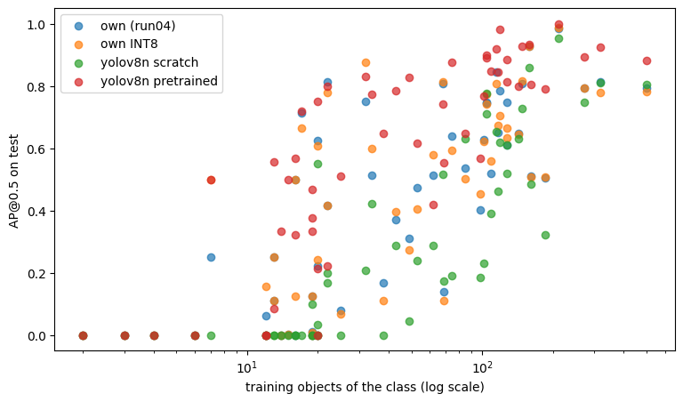
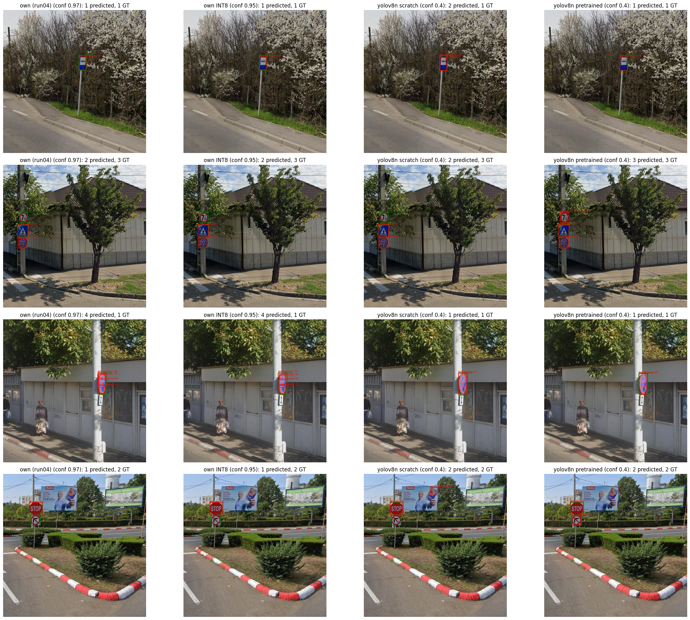

# Final comparison and quantization

This repo's model (run04) and its INT8 version against Ultralytics YOLOv8n, trained
from scratch and fine-tuned from COCO weights, on the same data. Produced with
`colab/compare_models.ipynb` and `benchmark.py`; all models are scored by the same code
(`train/metrics.py`, `train/analysis.py`) on the same images.

The [final results](#final-results-test-split) are on the test split. The
[earlier val comparison](#earlier-comparison-val-split) is kept below because it records
a hypothesis that was tested and failed.

## Protocol

| matched (defines the task) | each model's own (defines the method) |
|---|---|
| same data split (the saved `manifest.json`) | training recipe (augmentation, optimizer, LR schedule, losses) |
| input size 320 | resizing: Ultralytics letterboxes, the own model stretches |
| 100-epoch budget, best checkpoint chosen on val | post-processing: NMS IoU chosen per model on val (0.5 / 0.6 / 0.7) |
| no horizontal flips, repeat-factor sampling | confidence operating point: each model's best-F1 threshold on val |
| scoring code: mAP at conf 0.001, same matching | |

NMS IoU and confidence were fixed on val, then applied once to test.

## Final results (test split)

| | own (run04) | own INT8 | YOLOv8n scratch | YOLOv8n pretrained |
|---|---|---|---|---|
| parameters | 3.57M | same | 3.02M | 3.02M |
| GFLOPs at 320x320 | 1.92 | same | 2.03 | 2.03 |
| NMS IoU (from val) | 0.5 | 0.5 | 0.5 | 0.5 |
| **mAP@0.5** | 0.431 | 0.438 | 0.293 | **0.591** |
| mAP@[.5:.95] | 0.320 | 0.311 | 0.232 | **0.507** |
| class-agnostic mAP@0.5 | 0.680 | 0.662 | 0.764 | **0.927** |
| mAP lost to wrong classes | 0.248 | 0.225 | 0.471 | 0.336 |
| confidence (from val) | 0.97 | 0.95 | 0.40 | 0.40 |
| precision | 0.837 | 0.748 | 0.801 | **0.870** |
| recall | 0.500 | 0.511 | 0.459 | **0.734** |
| F1 | 0.626 | 0.607 | 0.584 | **0.796** |

*Class-agnostic mAP: every label set to one class -- "found the object, box in the
right place". Its gap to mAP@0.5 is what classification mistakes cost, but a model can
only lose what it first found, so that gap isn't comparable on its own: pretrained loses
more than the own model because it has more to lose. Confidence thresholds aren't
comparable across models either.*

### Per class

Mean AP@0.5 by how many training objects a class has. Full table:
[per_class_test.csv](per_class_test.csv).

| training objects per class | classes scored | own | own INT8 | YOLOv8n scratch | YOLOv8n pretrained |
|---|---|---|---|---|---|
| < 20 | 17 | 0.119 | 0.143 | 0.006 | **0.280** |
| 20-99 | 18 | 0.432 | 0.435 | 0.229 | **0.599** |
| 100-499 | 17 | 0.722 | 0.714 | 0.618 | **0.877** |
| >= 500 | 1 | 0.793 | 0.783 | 0.805 | **0.882** |

Class by class, the own model is ahead of YOLOv8n scratch on 39 classes, behind on 5
and tied on 9. It's ahead of YOLOv8n pretrained on 7, behind on 40 and tied on 6. Six
classes score 0 for all four models, five of them with at most 12 training objects;
`forb_speed_over_60` has 20. `forb_speed_over_130` has no test objects and isn't scored.

### Recall by object size

Share of objects found with the right class, by longest side in 320x320 model-input
pixels. "max" = at conf 0.001 (the most a model finds at all); "op" = at its confidence
threshold from val.

| size (px) | 0-16 | 16-32 | 32-64 | 64-128 | >=128 |
|---|---|---|---|---|---|
| objects in test | 209 | 305 | 243 | 142 | 13 |
| own, max | 0.455 | 0.807 | 0.926 | 0.965 | 0.923 |
| own, op | 0.105 | 0.495 | 0.650 | 0.810 | 0.769 |
| own INT8, max | 0.474 | 0.803 | 0.938 | 0.965 | 0.923 |
| own INT8, op | 0.105 | 0.495 | 0.683 | 0.824 | 0.769 |
| YOLOv8n scratch, max | 0.349 | 0.685 | 0.856 | 0.923 | 0.923 |
| YOLOv8n scratch, op | 0.091 | 0.420 | 0.613 | 0.796 | 0.769 |
| YOLOv8n pretrained, max | **0.584** | **0.866** | **0.975** | **0.986** | 0.923 |
| YOLOv8n pretrained, op | **0.306** | **0.757** | **0.942** | **0.937** | **0.923** |

### Example predictions

*Green: ground truth. Red: predictions, at each model's own threshold. Four images,
illustrative only. The third row shows the own model's failure in both versions: four
boxes on one sign, even at conf 0.97 / 0.95.*

## What it shows

1. **Pretraining is the largest effect measured.** With the same architecture and recipe,
   COCO weights take YOLOv8n from 0.293 to 0.591, more than the gap between any other
   two models here.
2. **Against YOLOv8n from scratch, the own model classifies better and localizes worse.**
   It leads on mAP@0.5 (0.431 vs 0.293) while YOLOv8n leads on class-agnostic mAP (0.764
   vs 0.680). The own model also loses relatively more when the IoU requirement tightens
   (mAP@[.5:.95] / mAP@0.5: 0.74 vs 0.79 and 0.86 for pretrained), which suggests looser
   boxes. Both are consistent with its simpler L1 box loss and fixed size ranges against
   DFL + CIoU and dynamic assignment, but no run isolated those.
3. **Pretrained's lead over the own model looks like detection more than classification.**
   Its class-agnostic mAP is 0.927 vs 0.680, while both keep about 64% of it once classes
   count. This is a rough reading: mAP isn't really a product of the two.
4. **The own model's confidence ranks its detections poorly.** On 32-64 px objects it can
   reach 0.926 recall at conf 0.001 but 0.650 at its threshold; pretrained goes from
   0.975 to 0.942. Its best threshold is 0.97, its scores bunch near 1, and duplicate
   boxes survive there (third row above). Consistent with the late overfitting in
   [run04](../run04_long/README.md).
5. **Small objects and rare classes are hard for every model.** 56% of test objects are
   under 32 px, and at its threshold even pretrained finds only 31% of those under 16 px.

## Quantization

ONNX Runtime static post-training quantization of run04's `best.pt` (`quantize_model.py`,
`colab/quantize_own_model.ipynb`): QDQ format, per-channel QInt8 weights, QUInt8
activations, MinMax calibration on 200 training images.

| | FP32 | INT8 | change |
|---|---|---|---|
| ONNX size | 14.34 MB | 3.96 MB | 3.6x smaller |
| median latency, 1 thread | 17.7 ms | **8.1 ms** | 2.2x faster |
| median latency, 2 threads | 9.5 ms | **5.8 ms** | 1.6x faster |
| median latency, 4 threads | 8.0 ms | **7.1 ms** | 1.1x faster |
| mAP@0.5 | 0.431 | 0.438 | +0.006 |
| mAP@[.5:.95] | 0.320 | 0.311 | -0.008 |
| class-agnostic mAP@0.5 | 0.680 | 0.662 | -0.017 |
| F1 | 0.626 | 0.607 | -0.019 |

Full `benchmark.py` output (100 runs per row; Intel i5-1335U, 12 logical CPUs,
onnxruntime 1.31.0, 320x320):

| model | threads | mean ms | median ms | p95 ms |
|---|---|---|---|---|
| fp32 | 1 | 18.5 | 17.7 | 21.6 |
| fp32 | 2 | 9.5 | 9.5 | 9.8 |
| fp32 | 4 | 8.2 | 8.0 | 9.3 |
| int8 | 1 | 8.1 | 8.1 | 8.7 |
| int8 | 2 | 6.3 | 5.8 | 8.0 |
| int8 | 4 | 7.4 | 7.1 | 9.2 |

- **Accuracy is about level, not better.** The +0.006 in mAP@0.5 is too small to read as a
  gain: per-class AP moves between -0.08 and +0.25, with INT8 ahead on 18 classes and
  behind on 20. The measures that rest on all 912 objects, class-agnostic mAP and F1,
  dip slightly. Precision drops more at the operating point (0.837 to 0.748, at thresholds
  0.97 and 0.95).
- **Speed:** the largest gain is on one thread. INT8 is fastest on 2 threads and slows
  down at 4, while FP32 still improves slightly. The cause wasn't investigated.
- **Limits:** one sitting on one laptop, not an edge device, with thread counts as the
  only constraint simulated. Latency is model inference only (`session.run`), without
  pre-processing or NMS. Absolute times vary: an earlier run with untrained placeholder
  weights took 24 ms (FP32) and 12 ms (INT8) on 1 thread. Ratios are safer to quote than
  milliseconds.
- FP32 accuracy comes from the PyTorch checkpoint, whose ONNX export has a parity check;
  FP32 latency comes from the exported ONNX model.

## Caveats

- **Unequal tuning.** The own model's recipe was developed over four runs on this val
  split, and YOLOv8n used Ultralytics' defaults. So this says the own model beat YOLOv8n
  from scratch under this protocol, not that it's a better architecture. Why YOLOv8n from
  scratch does this poorly is unexplained (see below).
- **Small samples.** 27 of the 53 scored classes have fewer than 10 test objects, and
  mAP weights every class equally, so per-class differences are mostly noise.
- **One training run per model:** run-to-run noise is unknown (the own model's
  checkpoints move by about +-0.01 near the end of training).
- **Test split:** scored once for these numbers. Run04's test prediction pictures had been
  looked at earlier, but nothing was tuned on them.
- **Checkpoint selection differs.** Ultralytics picks `best.pt` with its own score
  (weighted 90% to mAP@[.5:.95]), the own model by mAP@0.5.
- **Ultralytics' own numbers differ from ours.** It reports about 0.63 mAP50 for the
  pretrained run on val near its best epoch, against 0.581 from this repo's scorer at NMS
  0.7. Its matching differs, which is the likely reason, but this wasn't confirmed. Only
  this repo's scorer is used here.
- **Different environments.** The pretrained run used a newer Colab (NumPy 2.4, with a
  one-line `np.trapz` shim for Ultralytics 8.3.40) than the scratch run.
- Resizing differs (letterbox vs stretch); not isolated.

## If this were continued

- Own model, localization: box loss (DFL + CIoU), task-aligned target assignment,
  separate box/class head branches.
- Own model, duplicates and confidence: the third-row failure above.
- Pretrained backbone for the own model, given how much pretraining buys YOLOv8n.
- Input size: 56% of objects under 32 px at 320 input suggests resolution is a limit for
  every model. It would also trade directly against latency.

---

## Earlier comparison (val split)

This came before the pretrained run and led to the "no flips + repeat-factor sampling"
recipe used above. YOLOv8n was trained from scratch twice:

- **default**: Ultralytics' default recipe, unchanged. That recipe mirrors images
  horizontally (`fliplr=0.5`), which turns a "turn left" sign into a "turn right" sign
  with the wrong label, and doesn't rebalance rare classes.
- **no-flip + rfs**: `fliplr=0.0`, plus repeat-factor sampling with the own model's
  factors (rare-class train images written several times, see
  `data/yolo_format.py`). Everything else unchanged.

| val split | own (run04) | YOLOv8n default | YOLOv8n no-flip + rfs |
|---|---|---|---|
| best NMS IoU | 0.5 | 0.5 | 0.5 |
| **mAP@0.5** | **0.402** | 0.283 | 0.284 |
| class-agnostic mAP@0.5 | 0.678 | **0.769** | 0.759 |
| mAP lost to wrong classes | **0.276** | 0.486 | 0.475 |
| best-F1 confidence | 0.97 | 0.30 | 0.40 |
| precision / recall at best F1 | **0.853** / 0.494 | 0.693 / 0.491 | 0.800 / 0.473 |
| F1 | **0.626** | 0.575 | 0.594 |

NMS IoU barely matters for either model (own: 0.402 / 0.399 / 0.392 at 0.5 / 0.6 / 0.7;
YOLOv8n default: 0.283 / 0.283 / 0.282).

**The hypothesis.** Against the default recipe, the gap sat in rare classes (< 20 training
objects: 0.111 vs 0.012) and in direction-dependent signs (`mand_left` 0.750 vs 0.000,
`forb_right` 0.751 vs 0.414), which pointed at mirroring and the lack of class rebalancing.

**The result: they aren't the explanation.** Removing the flips and adding repeat-factor
sampling left mAP unchanged (0.283 -> 0.284) and classification nearly so (0.486 -> 0.475
lost to wrong classes). It made YOLOv8n more precise at its operating point (0.69 -> 0.80),
but not a better classifier.

**Other candidates, untested** (no further runs were budgeted):

- **Mosaic at 320px.** Mosaic packs four images into one, roughly halving each: a median
  29px sign is trained at ~15px most of the time -- enough to find a sign, often not
  enough to read "30" vs "50" or an arrow's direction. The own model never shrinks images
  below 0.7x.
- **Loss weighting.** Ultralytics weights its box losses well above the class loss (box
  7.5, DFL 1.5, class 0.5).

The pretrained run shares both of these and still classifies well, so neither can be the
whole story on its own. They may hurt mainly when features have to be learned from scratch.
