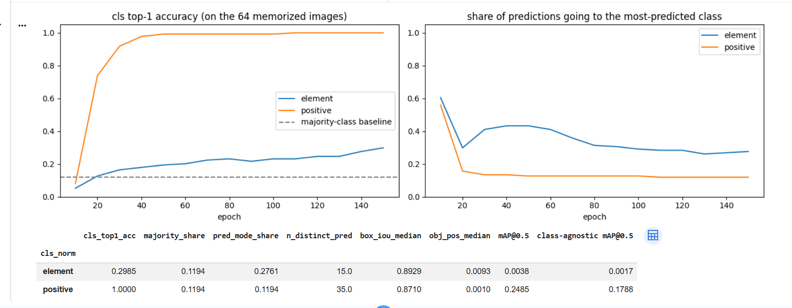
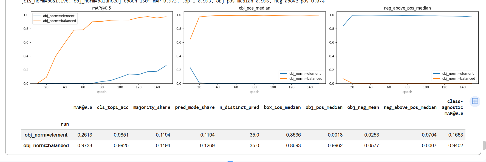

# Debugging the first training runs

Before [run01_baseline](../run01_baseline/README.md), every run reported a validation
mAP@0.5 of exactly 0.0000 while all three losses kept falling. Three separate bugs
were behind it, each found by measuring one part of the detector in isolation,
and each fix confirmed with a single-variable experiment.

Tools used (all in this repo):

- `train/diagnostics.py: branch_stats` -- reads each head branch directly at the
  ground-truth cells, bypassing decode/NMS/mAP: objectness at object vs. empty cells,
  classification top-1 against a majority-class baseline, IoU of the predicted box.
- `evaluate_map(..., class_agnostic=True)` -- mAP with every label set to one class,
  so it measures "found the object, box in the right place" with classification
  taken out.
- `colab/debug_own_model.ipynb` -- runs both, plus a 64-image overfit test.

## Bug 1: the evaluation threshold hid real detections

`evaluate_map` filtered predictions at a confidence of 0.3 before scoring -- a
deployment threshold used as an evaluation one. mAP already integrates over every
confidence level, so a cutoff only truncates the precision/recall curve; early in
training, true positives scored well below 0.3 and were all dropped. The
`--conf-thresh` CLI flag also wasn't wired through to evaluation.

Same checkpoint (decoupled-objectness design, epoch 26), val split:

| conf_thresh | mAP@0.5 | class-agnostic mAP@0.5 |
|---|---|---|
| 0.3 | 0.0000 | 0.0000 |
| 0.01 | 0.0045 | 0.2547 |
| 0.001 | 0.0052 | 0.2650 |

**Fix:** evaluation now defaults to conf_thresh 0.001 (Ultralytics' validation
value), and the CLI flag is passed through.

Note: the earlier merged-objectness head (YOLOv8's actual design, see the main
README) was also evaluated at 0.3, so its reported ~0 mAP was affected by the same
bug. The decoupled design was kept because it works, but that comparison was not
a fair one.

## Bug 2: the classification loss was scaled down by the number of classes

`branch_stats` on that same checkpoint:

| | val | train (1,000 images) |
|---|---|---|
| cls top-1 at object cells | 0.192 | 0.188 |
| majority-class share (`info_crosswalk`) | 0.125 | 0.132 |
| share of predictions = most-predicted class (`info_crosswalk`) | 0.592 | 0.610 |
| box IoU median (share >= 0.5) | 0.822 (91.0%) | 0.866 (96.5%) |
| empty cells scored above the median object cell | 0.22% | 0.27% |

Boxes and objectness ranking were fine; class-agnostic mAP was ~50x the normal
mAP. The classifier had collapsed onto the most frequent class, equally on train and
val -- so it wasn't learning, not overfitting.

Cause: the cls BCE was a `.mean()` over (positive cells x 54 classes). The single
correct class got 1/54 of a gradient while 53 "not this class" targets pulled every
logit down, so outputting the class frequencies everywhere was the cheapest way to
lower the loss.

**Fix:** `cls_norm="positive"` -- sum the BCE over classes, divide by the number of
positive cells (YOLOv8's normalization).

**Check:** a fresh model trained on 64 training images, scored on those same images
(same seed; only `cls_norm` differs):

| cls_norm | cls top-1 | mAP@0.5 |
|---|---|---|
| element (old) | 0.2985 | 0.0038 |
| positive (new) | **1.0000** | 0.2485 |

## Bug 3: objectness was drowned by empty cells

With classification fixed, the same overfit test still only reached mAP 0.25 on
images the model had memorized, and objectness at object cells had a median of
0.001. The obj loss was one weighted mean over all ~2,100 cells per image (320px,
strides 8/16/32), of which only one or two are positive -- positives were ~0.05% of
that mean, and a 0.5 down-weight on empty cells (YOLOv1's value, chosen for a
49-cell grid) couldn't compensate. Predicting ~0 everywhere was the cheapest
solution.

**Fix:** `obj_norm="balanced"` --
`obj_weight * mean BCE over object cells + noobj_weight * mean BCE over empty cells`,
so the positive term doesn't shrink as the grid grows.

**Check:** same 64-image overfit test, both runs with `cls_norm="positive"`:

| obj_norm | mAP@0.5 | obj at object cells (median) | empty cells above median object cell | cls top-1 | box IoU median |
|---|---|---|---|---|---|
| element (old) | 0.2613 | 0.0018 | 97.04% | 0.9851 | 0.8636 |
| balanced (new) | **0.9733** | **0.9962** | **0.07%** | 0.9925 | 0.8693 |

## The common thread

Bugs 2 and 3 are the same mistake: averaging a loss over many elements when only a
few of them carry the signal. Normalizing by the number of positives instead is
what YOLOv8 does, for this reason.
