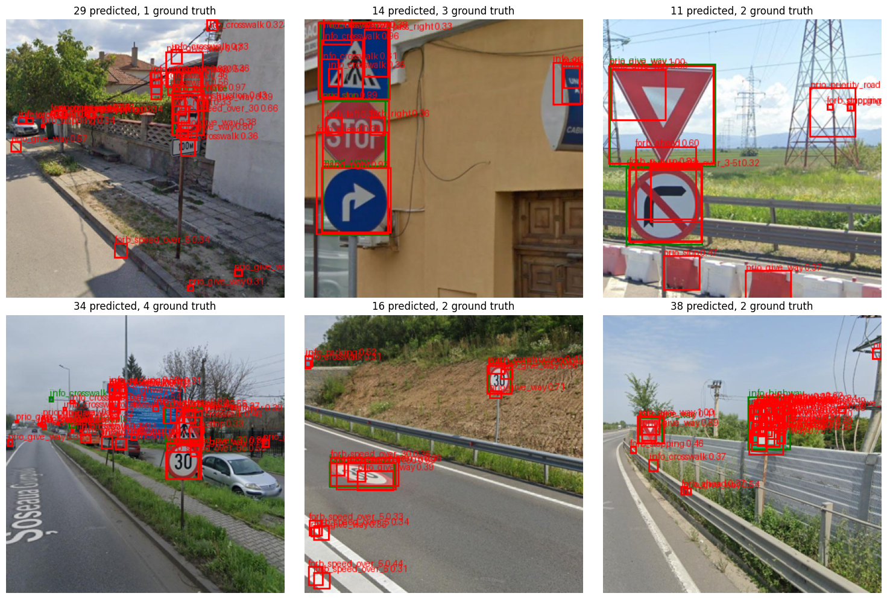
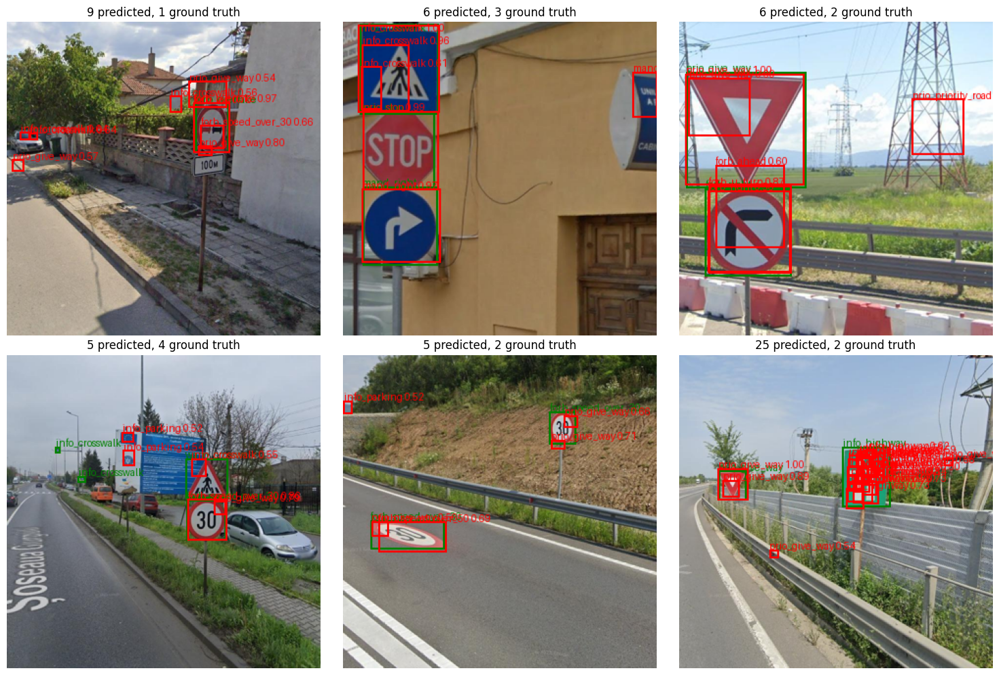

# run02_augment

Same model, loss and data split as [run01_baseline](../run01_baseline/README.md); the
changes target run01's overfitting and loss spikes. Commit: `ecf69ed`.

## What changed from run01

| | run01 | run02 |
|---|---|---|
| augmentation | none | random scale 0.7-1.3x + shift up to 10% (boxes moved with the image), colour jitter (small hue shift), **no flips** |
| optimizer | Adam, no weight decay | AdamW, weight decay 0.01 on conv weights only |
| learning rate | constant 1e-3 | 3-epoch linear warmup to 1e-3, cosine decay to 1e-5 at epoch 50 |
| DataLoader workers | 0 | 2 |

Everything else is unchanged: 320 x 320 input, strides 8/16/32 with size thresholds
32/80px, 50 epochs, batch size 16, `cls_norm="positive"`, `obj_norm="balanced"`,
repeat-factor sampling, eval at conf_thresh 0.001 with per-class NMS at IoU 0.5.

## Results

| metric | run01 | run02 |
|---|---|---|
| **best val mAP@0.5** | 0.1559 (epoch 46) | **0.2538** (epoch 47) |
| final val mAP@0.5 | 0.1270 | **0.2533** |
| val cls loss | lowest at epoch 18 (8.36), then rising to 11-13 | falls the whole run: 31.1 -> **5.46** |
| final train / val cls loss | 0.59 / 12.41 | 3.22 / 5.46 |
| loss spikes | epochs 29, 48 (train cls 0.50 -> 2.24) | one small bump, epoch 21 (5.61 -> 6.45) |

+63% best mAP. Full per-epoch log, with timings: [train_log.txt](train_log.txt).

## Timing

~88s per epoch, ~1h14m for the run:

| phase | per epoch |
|---|---|
| training | ~48s |
| val loss | ~5s |
| val mAP | 33-41s |

The mAP computation (pure Python, CPU) is ~40% of each epoch -- a faster GPU
wouldn't touch it. Since this run, mAP is computed every 5 epochs by default
(`--map-every`), which brings an epoch down to ~55s.

## Predictions on test images

`best.pt`, per-class NMS, same six test images as run01. Green = ground truth,
red = predictions.

**conf 0.3**

**conf 0.5**

**conf 0.7**

## Observations

1. **The overfitting is gone.** Val cls loss now falls with train cls loss instead
   of turning around at epoch 18, and the train/val gap is small.
2. **The model is now under-trained.** Val mAP was still rising when the learning
   rate reached its floor -- more epochs should help.
3. **Classes are mostly right at high confidence.** At conf 0.7: `info_crosswalk`
   1.00, `prio_stop` 0.99, `prio_give_way` 1.00, `forb_turn_right` 0.87,
   `forb_overtaking` 0.97, and the bottom-left 30 sign is labelled correctly -- most
   of these were wrong in run01.
4. **Stacked duplicate boxes remain** (bottom-right: 18 predictions at conf 0.7 for
   2 objects, nearly all stacked on the `info_highway` sign). Same cause as in run01: only one cell per object is
   trained.
5. **Many small, low-confidence false positives at conf 0.3** on road, grass and
   walls (mostly `prio_give_way`, `forb_speed_over_5`); nearly all are gone at 0.5.
   Unconfirmed guess: zoom-out augmentation teaches the model that signs can be very
   small.
6. **Misses are mostly tiny objects:** the two small crosswalk signs (bottom-left)
   and the "30" painted on the road (bottom-middle -- labelled `forb_speed_over_30`
   in the dataset), only a few pixels across at 320px.

## Next

- Center sampling (several positive cells per object) -> observation 4
- Longer training, now affordable with `--map-every 5` -> observation 2
- Larger input size, as part of the accuracy/latency trade-off -> observation 6
