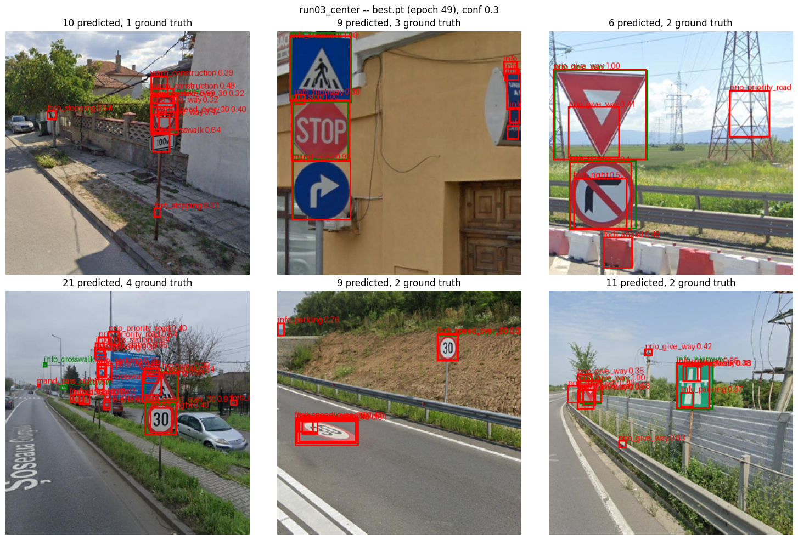
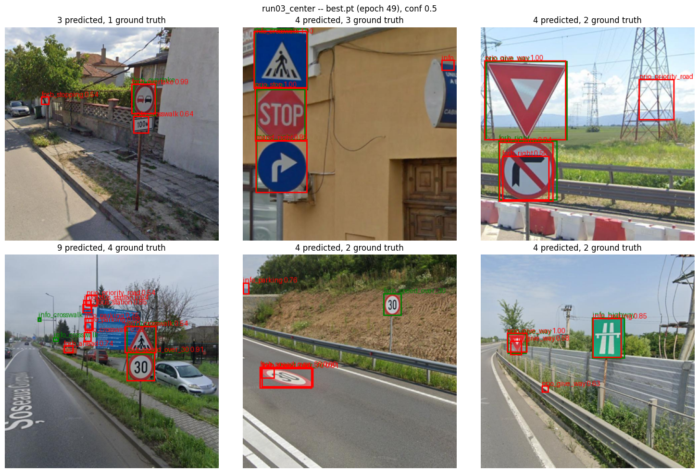

# run03_center

Same as [run02_augment](../run02_augment/README.md) plus one change: **center
sampling** in target assignment. Commit: `9bd8164`.

## What changed from run02

| | run02 | run03 |
|---|---|---|
| positive cells per object | 1 (the cell containing the box center) | up to 9: the center cell + its 8 neighbours whose centers lie inside the box (`--center-radius 1`) |
| val mAP computed | every epoch | every 5 epochs + the last (`--map-every 5`; no effect on training) |

Why: in run01 and run02, the cells next to an object's center cell were trained as
background, yet still fired at inference -- each with its own class guess and an
untrained box. Per-class NMS can't merge boxes of different classes, so signs ended
up under stacks of duplicate boxes. As positives, those cells learn the right class
and a real box (their (l, t, r, b) targets are all positive by construction), so NMS
collapses them -- and the classifier gets several examples per object instead of
one. Tiny boxes contain no neighbouring cell center and keep just the center cell.

Everything else is unchanged: 320 x 320, 50 epochs, batch 16, AdamW (wd 0.01),
warmup + cosine LR, augmentation, `cls_norm="positive"`, `obj_norm="balanced"`,
repeat-factor sampling, eval at conf_thresh 0.001 with per-class NMS at IoU 0.5.

## Results

Val mAP@0.5 at the epochs both runs evaluated:

| epoch | 4 | 9 | 14 | 19 | 24 | 29 | 34 | 39 | 44 | 49 |
|---|---|---|---|---|---|---|---|---|---|---|
| run02 | 0.0048 | 0.0517 | 0.0934 | 0.1338 | 0.1617 | 0.1854 | 0.2188 | 0.2457 | 0.2433 | 0.2533 |
| run03 | 0.0182 | 0.0640 | 0.1080 | 0.1552 | 0.1756 | 0.2346 | 0.2648 | 0.2885 | 0.2871 | **0.2929** |

| metric | run02 | run03 |
|---|---|---|
| **best val mAP@0.5** | 0.2538 (epoch 47) | **0.2929** (epoch 49) |
| val mAP@0.5 at epoch 49 | 0.2533 | **0.2929** (+16%) |
| final val cls loss | 5.46 | 4.97 (not directly comparable: more, harder positives per object) |

run03 is ahead at every shared checkpoint, and the gap holds at the end, with the
learning rate at its floor -- so center sampling raises where training ends up, not
only how fast it gets there. The last three checkpoints (0.2885, 0.2871, 0.2929)
suggest it's levelling off at this learning-rate floor.

Note: run02's best (epoch 47) falls between run03's mAP epochs; the like-for-like
comparison is the table above.

Full per-epoch log, with timings: [train_log.txt](train_log.txt).

## Timing

~56 minutes for the run (run02: ~1h14m):

| phase | per epoch | run02 |
|---|---|---|
| training | ~54s | ~48s |
| val loss | ~6s | ~5s |
| val mAP (every 5th epoch) | ~33s | 33-41s, every epoch |

Training is ~6s slower per epoch -- most likely the target-assignment loop, which
now visits up to 9 cells per box in Python (not measured; a different Colab GPU
would also explain it).

## Predictions on test images

`best.pt` (epoch 49), per-class NMS, same six test images as run01 and run02.
Green = ground truth, red = predictions.

**conf 0.3**

**conf 0.5**

**conf 0.7**

## Observations

1. **The duplicate stacks are gone.** At conf 0.7 there's mostly one box per sign;
   bottom-right went from 18 predictions (run02) to 2 for its 2 objects.
2. **Classes are mostly right:** `forb_overtake` 0.99, `info_crosswalk` 1.00,
   `prio_stop` 1.00, `prio_give_way` 1.00 (twice), `forb_turn_right` 0.94,
   `forb_speed_over_30` 0.91.
3. **The road-painted "30"** (bottom-middle) behaves as in run02: detected at conf
   0.3 and 0.5, missed at 0.7.
4. **Persistent background false positives,** with growing confidence: a
   `prio_priority_road` box on empty sky by the pylon (top-right; also in run02, at
   every threshold), and `info_parking` on the wall corner (bottom-middle; 0.52 in
   run02, 0.76 now).
5. **Small objects are still the weak spot:** the two tiny crosswalk signs
   (bottom-left) are missed, and the 30 sign on the post (bottom-middle) only scores
   between 0.3 and 0.5 -- the 320px input limit.
6. **Look-alike classes get confused:** the green highway sign (bottom-right) is
   labelled `info_parking` (0.85).
7. **At conf 0.3, clusters of differently-labelled boxes remain on some signs** --
   class-agnostic NMS (`decode_predictions(..., class_agnostic_nms=True)`) would merge
   them for deployment.

## Next

The training recipe is now: loss fixes + augmentation + LR schedule + center
sampling, each measured on its own.

- One long final run (100 epochs) with this recipe -> the model used for the YOLOv8n
  comparison and for quantization
- YOLOv8n trained from scratch under the same settings
- Input size (observation 5) as an accuracy-vs-latency trade-off in the
  benchmarking phase, for both models
