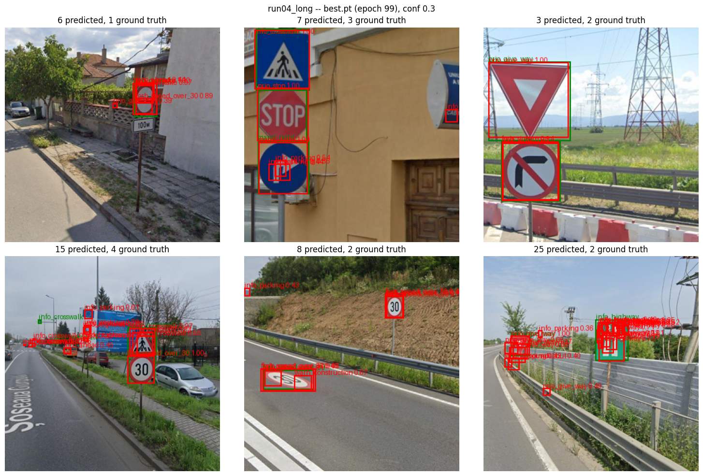
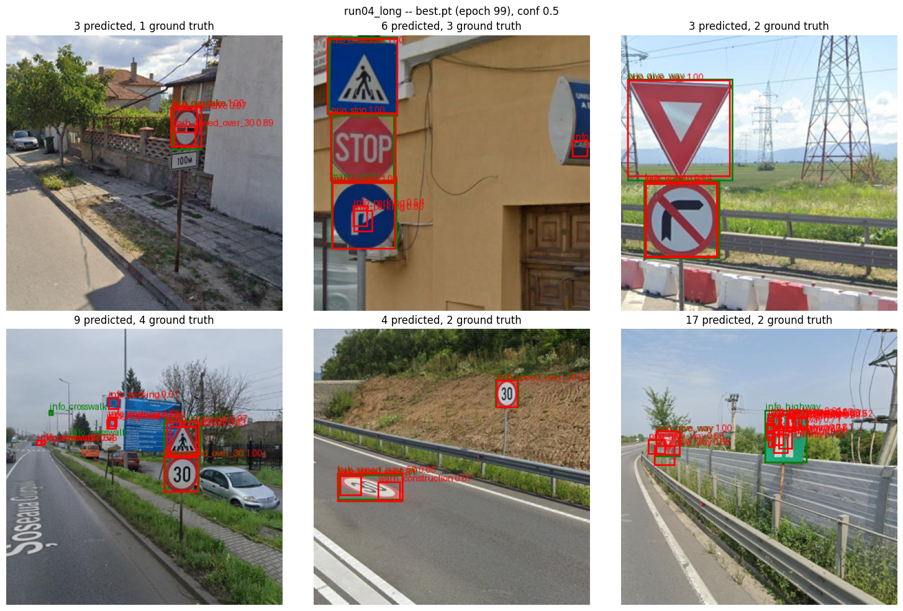
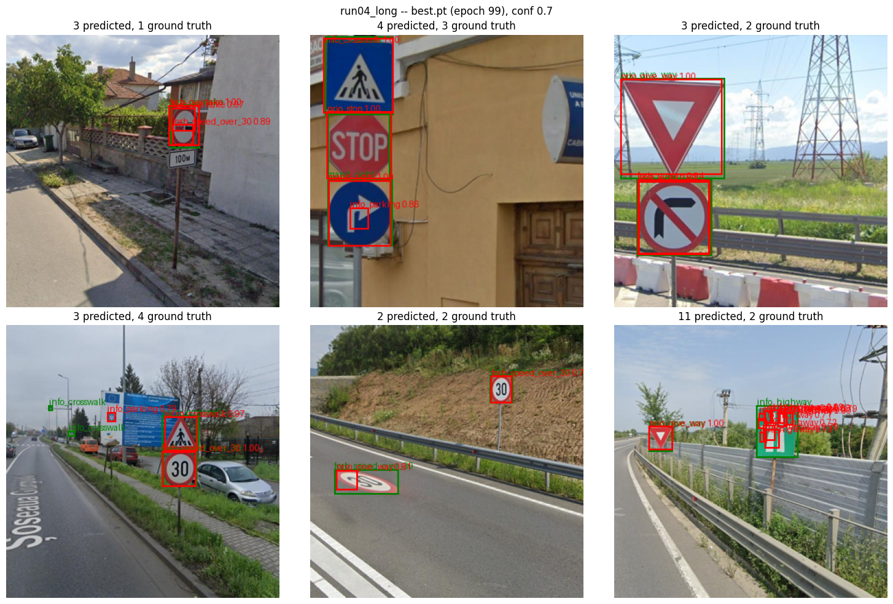

# run04_long

The settled recipe from [run03_center](../run03_center/README.md), trained twice as
long. Commit: `696eb98`.

## What changed from run03

| | run03 | run04 |
|---|---|---|
| epochs | 50 | **100** |

That's the only change; the cosine schedule stretches over the longer run (3-epoch
warmup to 1e-3, decay to 1e-5 at epoch 100). Everything else as in run03: 320 x 320,
batch 16, AdamW (wd 0.01), augmentation (scale/translate + colour jitter, no flips),
center sampling (radius 1), `cls_norm="positive"`, `obj_norm="balanced"`,
repeat-factor sampling, eval at conf_thresh 0.001 with per-class NMS at IoU 0.5,
val mAP every 5 epochs.

## Results

| metric | run03 (50 epochs) | run04 (100 epochs) |
|---|---|---|
| **best val mAP@0.5** | 0.2929 (epoch 49) | **0.4016** (epoch 99, +37%) |
| val mAP@0.5 at epoch 49 | 0.2929 | 0.3065 |
| final train cls / obj loss | 3.17 / 0.21 | 1.18 / 0.12 |
| final val cls / obj loss | 4.97 / 0.41 | 4.55 / **0.70** |

Val mAP@0.5 every 5 epochs:

| epoch | 9 | 19 | 29 | 39 | 49 | 59 | 69 | 79 | 89 | 99 |
|---|---|---|---|---|---|---|---|---|---|---|
| run04 | 0.064 | 0.149 | 0.219 | 0.256 | 0.307 | 0.336 | 0.362 | 0.393 | 0.400 | **0.402** |

- **Run04 had already passed run03 at epoch 49** (0.307 vs 0.293), with its learning
  rate still at ~half the peak; the second half, at low learning rate, added +0.10.
- **It has plateaued:** 0.393, 0.397, 0.400, 0.399, 0.402 over the last 20 epochs.
  More epochs with this recipe would add little.

Full per-epoch log, with timings: [train_log.txt](train_log.txt).

## Late overfitting

| epoch | 49 | 59 | 69 | 79 | 89 | 99 |
|---|---|---|---|---|---|---|
| train cls loss | 3.04 | 2.39 | 1.94 | 1.51 | 1.28 | 1.18 |
| val cls loss | 5.81 | 4.59 | 5.03 | 4.20 | 4.70 | 4.55 |
| train obj loss | 0.23 | 0.20 | 0.16 | 0.14 | 0.13 | 0.12 |
| val obj loss | 0.50 | 0.56 | 0.50 | 0.72 | 0.69 | 0.70 |

From epoch ~60 train cls loss keeps falling while val cls loss stays flat, and from
epoch ~70 **val objectness loss rises** while train objectness keeps falling. The model
becomes *confident* about things that don't generalize -- the predictions below show
what. mAP still rose over the same epochs (ranking kept improving overall), so the
last checkpoint is still the best one.

## Timing

~1h52m for the run: ~56s training + ~5s val loss per epoch, plus ~22-40s of val mAP
every 5th epoch.

## Predictions on test images

`best.pt` (epoch 99), per-class NMS, same six test images as all earlier runs.
Green = ground truth, red = predictions.

**conf 0.3**

**conf 0.5**

**conf 0.7**

## Observations

1. **A new failure: small, confident boxes on parts *inside* a larger sign.** At
   conf 0.7: the arrow inside the blue arrow sign (top-middle) becomes `info_parking`
   (0.88); the pictograms on the green highway sign get 11 small boxes (bottom-right --
   run03 had cleaned this image up to 2); a `forb_speed_over_30` box (0.89) sits inside
   the `forb_overtake` sign (top-left). NMS can't remove these: a small box inside a
   large one has low IoU with it, per-class or class-agnostic alike. Likely cause: at
   the small-object scale, the cells inside a large sign are trained as background, but
   an inner pictogram looks much like a small sign -- with limited data the model
   memorizes rather than learns the difference. Consistent with the rising val
   objectness loss above.
2. **The recurring background false positives are gone** at conf 0.7: the
   `prio_priority_road` box on the sky by the pylon (top-right) and the `info_parking`
   on the wall (bottom-middle), both present in run02 and run03.
3. **Most signs are found with the right class at 1.00:** `forb_overtake`,
   `info_crosswalk`, `prio_stop`, the blue arrow sign, `prio_give_way` (twice),
   `forb_speed_over_30` (bottom-left).
4. **The road-painted "30"** (bottom-middle) now gets a box at conf 0.7 -- though
   only around part of it.
5. **The two tiny crosswalk signs** (bottom-left) are still missed at every threshold.

The six images are fixed and hand-picked to be hard, and two of them got worse; mAP,
over the whole val set, improved 37%. They show the *kind* of errors left, not the
overall trend.

## Next

- **A reference point:** YOLOv8n trained from scratch on the same split, 320px, 100
  epochs, scored with this repo's mAP code -- without it, 0.40 can't be judged as good
  or weak for a from-scratch model on this data
- **Per-class AP vs. training examples per class:** whether rare classes (some have
  only a handful of training images) are what limits mAP, i.e. whether the late
  overfitting is a data problem
- If data-limited: mosaic and copy-paste augmentation
